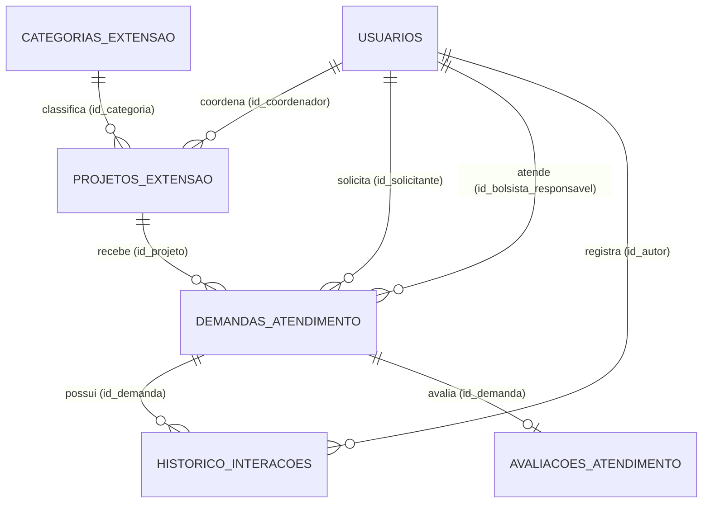

# Modelagem do Banco de Dados — Sistema de Gestão de Atendimento e Demandas de Projetos de Extensão (UFMS)

## 1. Visão Geral da Modelagem
O modelo relacional foi projetado para sustentar a persistência de dados do **Sistema Web de Gestão de Atendimento e Demandas de Projetos de Extensão Universitária da UFMS**, desenvolvido em continuidade ao protótipo front-end do Módulo 2. O esquema segue rigorosamente as três primeiras Formas Normais (**1FN, 2FN e 3FN**), eliminando redundâncias, anomalias de atualização e garantindo integridade referencial e de domínio.

---

## 2. Dicionário de Entidades, Atributos e Restrições

### 2.1. Entidade `usuarios`
Armazena todos os atores que interagem com a plataforma (comunidade externa, estudantes bolsistas, docentes coordenadores e administradores).
- `id_usuario` (`INTEGER PRIMARY KEY AUTOINCREMENT`): Identificador único do usuário.
- `nome_completo` (`VARCHAR(120) NOT NULL`): Nome civil completo.
- `email` (`VARCHAR(120) NOT NULL UNIQUE`): Endereço eletrônico institucional ou pessoal.
- `cpf` (`CHAR(11) NOT NULL UNIQUE`): Cadastro de Pessoa Física (apenas dígitos).
- `telefone` (`VARCHAR(20)`): Contato telefônico / WhatsApp.
- `perfil` (`VARCHAR(30) NOT NULL CHECK`): Restrição de domínio (`'SOLICITANTE_EXTERNO'`, `'DISCENTE_BOLSISTA'`, `'COORDENADOR'`, `'ADMIN'`).
- `ativo` (`BOOLEAN NOT NULL DEFAULT 1`): Indicador de conta ativa.
- `criado_em` (`DATETIME NOT NULL DEFAULT CURRENT_TIMESTAMP`): Data/hora de cadastro.

### 2.2. Entidade `categorias_extensao`
Classifica os projetos de extensão segundo as áreas temáticas definidas pela PROECE/UFMS.
- `id_categoria` (`INTEGER PRIMARY KEY AUTOINCREMENT`): Identificador único da categoria.
- `nome_categoria` (`VARCHAR(80) NOT NULL UNIQUE`): Nome da área temática (ex.: Tecnologia e Produção, Educação, Saúde, Direitos Humanos).
- `sigla_area` (`VARCHAR(10) NOT NULL`): Sigla padronizada da área de extensão.
- `descricao` (`TEXT`): Detalhamento do escopo da área temática.

### 2.3. Entidade `projetos_extensao`
Representa as ações e projetos de extensão ativos ou concluídos na UFMS.
- `id_projeto` (`INTEGER PRIMARY KEY AUTOINCREMENT`): Identificador único do projeto.
- `codigo_sigproj` (`VARCHAR(30) NOT NULL UNIQUE`): Código oficial de registro institucional (ex.: `95DX7.200525`).
- `titulo` (`VARCHAR(160) NOT NULL`): Título oficial da ação de extensão.
- `descricao` (`TEXT NOT NULL`): Resumo e objetivos do projeto.
- `id_categoria` (`INTEGER NOT NULL REFERENCES categorias_extensao(id_categoria)`): Chave estrangeira para a categoria temática.
- `id_coordenador` (`INTEGER NOT NULL REFERENCES usuarios(id_usuario)`): Chave estrangeira apontando para o docente coordenador responsável.
- `status_projeto` (`VARCHAR(25) NOT NULL CHECK`): Domínio restrito a `'EM_PLANEJAMENTO'`, `'ATIVO'`, `'SUSPENSO'`, `'CONCLUIDO'`.
- `data_inicio` (`DATE NOT NULL`): Data de início da vigência.
- `data_fim` (`DATE`): Data de encerramento previsto.

### 2.4. Entidade `demandas_atendimento`
Núcleo operacional do sistema; registra cada chamado ou solicitação aberta pela comunidade ou por participantes.
- `id_demanda` (`INTEGER PRIMARY KEY AUTOINCREMENT`): Identificador único da solicitação.
- `protocolo` (`VARCHAR(25) NOT NULL UNIQUE`): Código público de rastreamento (ex.: `UFMS-2026-0001`).
- `id_projeto` (`INTEGER NOT NULL REFERENCES projetos_extensao(id_projeto)`): Projeto de extensão destinatário da demanda.
- `id_solicitante` (`INTEGER NOT NULL REFERENCES usuarios(id_usuario)`): Usuário que abriu a solicitação.
- `id_bolsista_responsavel` (`INTEGER REFERENCES usuarios(id_usuario)`): Discente bolsista designado na triagem (pode ser nulo enquanto aguarda triagem).
- `titulo_demanda` (`VARCHAR(140) NOT NULL`): Assunto resumido da demanda.
- `descricao_solic` (`TEXT NOT NULL`): Detalhamento completo da necessidade apresentada.
- `prioridade` (`VARCHAR(15) NOT NULL CHECK`): Domínio restrito a `'BAIXA'`, `'MEDIA'`, `'ALTA'`, `'URGENTE'`.
- `status_demanda` (`VARCHAR(20) NOT NULL CHECK`): Domínio restrito a `'ABERTA'`, `'EM_TRIAGEM'`, `'EM_ANDAMENTO'`, `'CONCLUIDA'`, `'CANCELADA'`.
- `data_abertura` (`DATETIME NOT NULL DEFAULT CURRENT_TIMESTAMP`): Carimbo de tempo da abertura.
- `data_atualizacao` (`DATETIME NOT NULL DEFAULT CURRENT_TIMESTAMP`): Última movimentação.
- `data_conclusao` (`DATETIME`): Carimbo de encerramento efetivo.

### 2.5. Entidade `historico_interacoes`
Registra a trilha de auditoria (log de movimentações e pareceres técnicos) de cada demanda ao longo do ciclo de atendimento.
- `id_interacao` (`INTEGER PRIMARY KEY AUTOINCREMENT`): Identificador único do registro de histórico.
- `id_demanda` (`INTEGER NOT NULL REFERENCES demandas_atendimento(id_demanda) ON DELETE CASCADE`): Demanda vinculada.
- `id_autor` (`INTEGER NOT NULL REFERENCES usuarios(id_usuario)`): Usuário que registrou a movimentação/parecer.
- `status_anterior` (`VARCHAR(20)`): Estado anterior da demanda.
- `status_novo` (`VARCHAR(20) NOT NULL`): Novo estado atribuído.
- `parecer_tecnico` (`TEXT NOT NULL`): Observação técnica ou resposta enviada ao solicitante.
- `data_registro` (`DATETIME NOT NULL DEFAULT CURRENT_TIMESTAMP`): Data/hora da interação.

### 2.6. Entidade `avaliacoes_atendimento`
Armazena o feedback de satisfação do solicitante após a conclusão do atendimento (relacionamento 1:1 opcional com `demandas_atendimento`).
- `id_avaliacao` (`INTEGER PRIMARY KEY AUTOINCREMENT`): Identificador único da avaliação.
- `id_demanda` (`INTEGER NOT NULL UNIQUE REFERENCES demandas_atendimento(id_demanda) ON DELETE CASCADE`): Garante no máximo uma avaliação por demanda concluída.
- `nota` (`INTEGER NOT NULL CHECK (nota BETWEEN 1 AND 5)`): Escala Likert de 1 a 5 estrelas.
- `comentario` (`TEXT`): Depoimento ou sugestão de melhoria.
- `data_avaliacao` (`DATETIME NOT NULL DEFAULT CURRENT_TIMESTAMP`): Data/hora da avaliação.

---

## 3. Diagrama Entidade-Relacionamento (Mermaid ER)

---

## 4. Aplicação das Formas Normais
1. **Primeira Forma Normal (1FN)**: Todos os atributos são atômicos e monovalorados. O histórico de pareceres e interações foi isolado na tabela `historico_interacoes`, evitando campos multivalorados na tabela de demandas.
2. **Segunda Forma Normal (2FN)**: Todos os atributos não-chave dependem funcionalmente da totalidade da chave primária de sua respectiva relação. Dados do projeto ou da categoria não são repetidos nas demandas.
3. **Terceira Forma Normal (3FN)**: Não há dependências transitivas entre atributos não-chave. Informações da área temática (`nome_categoria`, `sigla_area`) residem exclusivamente em `categorias_extensao`, referenciadas por chave estrangeira em `projetos_extensao`.
